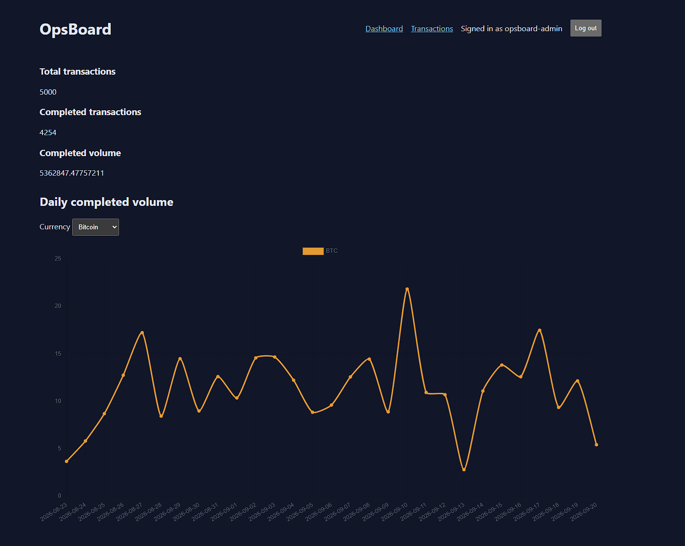
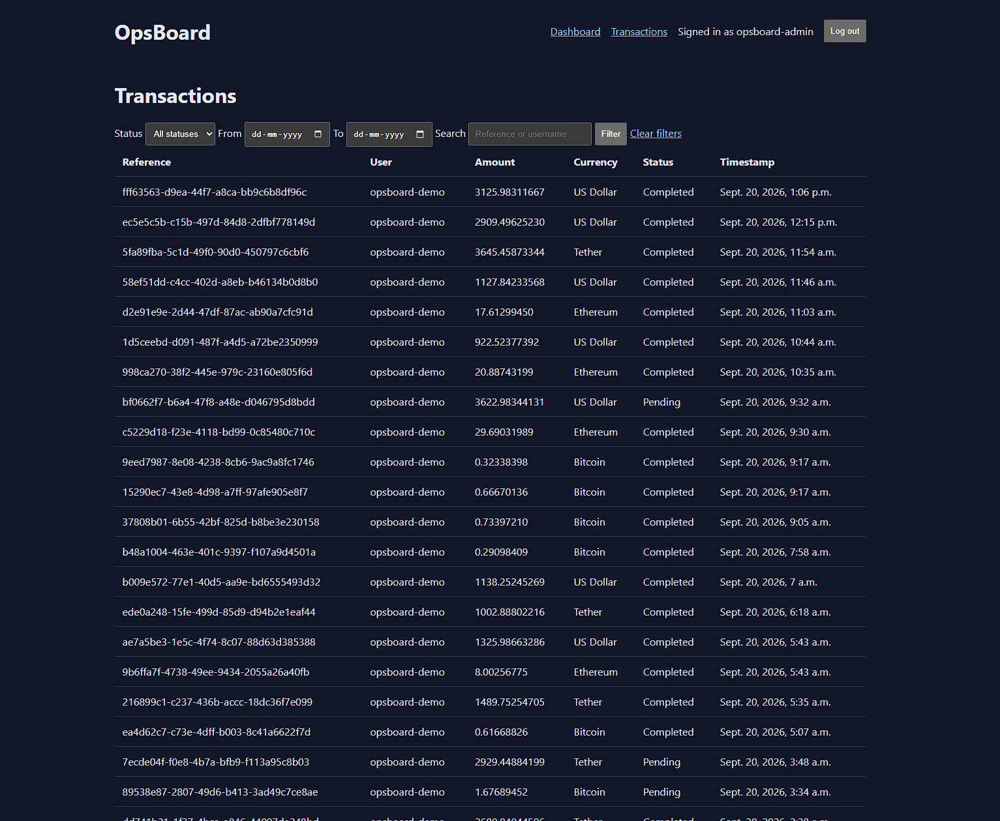
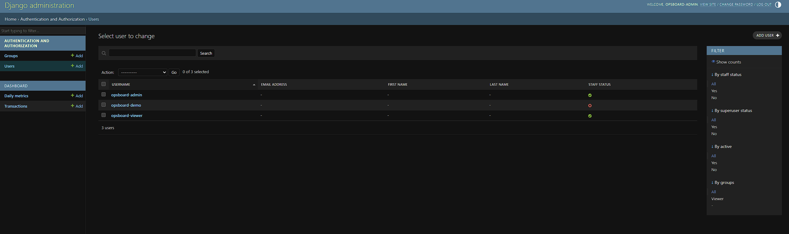

# OpsBoard

OpsBoard is a production-flavored internal transaction metrics dashboard built with Python and Django. It models a small operations tool for inspecting transaction activity, reviewing daily rollups, and giving administrators and view-only staff appropriately scoped access.

[Live demo](https://opsboard-logan-ak47.onrender.com/) | [GitHub repository](https://github.com/Logan-ak47/Dashboard)

> Render's free web service may take about a minute to wake after a period of inactivity.

## Demo login

```text
Username: opsboard-viewer
Password: OpsBoard-Viewer-2026!
```

The deliberately public viewer account can inspect the dashboard, API data, and Django admin records but cannot modify transactions. All deployed transaction data is generated and fictional. Administrator credentials remain private.

To sign out, use the **Log out** button in the application navigation. The login page also links back to this repository.

## Screenshots

### Metrics dashboard



### Filterable transaction list



### View-only Django admin



## Features

- Django session authentication for the server-rendered browser UI
- JWT access and refresh authentication for API clients
- Refresh-token rotation, blacklisting, ownership-checked logout, and short-lived access tokens
- Administrator and view-only roles backed by Django model permissions
- Transaction model with UUID references, exact decimal amounts, currencies, statuses, timestamps, and user ownership
- Precomputed daily metric rollups for reporting reads
- Management command that efficiently generates 5,000 realistic transactions
- Filterable, searchable, paginated HTML transaction list
- Paginated and currency-filterable transaction JSON API
- Administrator-only transaction status updates through the API
- Summary cards calculated with one conditional aggregate query
- Chart.js daily-volume visualization backed by an authenticated DRF endpoint
- Configured Django admin with columns, filters, search, date navigation, and efficient relationship loading
- Composite indexes for common status/time and currency/time query paths
- Idempotent production bootstrap for users, groups, and permissions
- 38 automated tests covering views, APIs, queries, permissions, JWT boundaries, CSRF, SQL injection, XSS, seeding, and deployment bootstrap behavior

## Architecture

OpsBoard uses Django's server-rendered Model-View-Template architecture for the browser dashboard and Django REST Framework for authenticated JSON APIs.

```text
Browser UI
  -> Django middleware
  -> URL resolver
  -> session-authenticated views
  -> templates / HTML

API client
  -> DRF authentication (JWT, then session)
  -> permission classes
  -> API view
  -> serializer / JSON

Django ORM
  -> SQLite locally
  -> PostgreSQL on Render
```

### Data model

- `Transaction` is the source-of-truth event record.
- `DailyMetric` is a denormalized rollup keyed by date and currency.
- Django's built-in `User`, `Group`, and `Permission` models provide identity and authorization.

Financial values use `DecimalField`, not floating point. Database constraints enforce positive transaction amounts and unique daily metrics. Relationship reads use `select_related("user")` to avoid N+1 queries.

### Authentication and authorization

The web UI keeps Django's built-in session login. Browsers automatically send the session cookie, and Django requires CSRF tokens for unsafe session-authenticated requests.

API clients may obtain a short-lived access token and a longer-lived refresh token. Access tokens authenticate business API requests through the `Authorization: Bearer <token>` header. Refresh tokens are rotated and the previous token is blacklisted. JWT logout verifies that the refresh token belongs to the authenticated caller before revoking it.

Authentication establishes `request.user`; permissions determine what that identity may do. Safe transaction reads require `dashboard.view_transaction`, while PATCH requires `dashboard.change_transaction`. Authorization checks capabilities rather than hard-coded group names.

## API

All request and response bodies use JSON.

### Obtain a token pair

```http
POST /api/auth/token/
Content-Type: application/json

{
  "username": "opsboard-viewer",
  "password": "..."
}
```

Successful response:

```json
{
  "access": "<short-lived-access-token>",
  "refresh": "<longer-lived-refresh-token>"
}
```

### Refresh tokens

```http
POST /api/auth/token/refresh/
Content-Type: application/json

{
  "refresh": "<refresh-token>"
}
```

Refresh rotation returns a new access/refresh pair and blacklists the submitted refresh token.

### JWT logout

```http
POST /api/auth/logout/
Authorization: Bearer <access-token>
Content-Type: application/json

{
  "refresh": "<refresh-token>"
}
```

Successful logout returns `204 No Content`. It prevents future refreshes; an access token already issued remains valid until its short expiry.

### Chart data

```http
GET /api/charts/daily-volume/
Authorization: Bearer <access-token>
```

The browser dashboard may call this endpoint through its Django session. The response contains aligned date labels and zero-filled currency datasets.

### Transaction collection

```http
GET /api/transactions/?currency=BTC&page=1&page_size=25
Authorization: Bearer <access-token>
```

Viewer and administrator accounts may read this endpoint. Pagination defaults to 25 rows and caps client-selected page size at 100.

```json
{
  "count": 5000,
  "next": "https://example/api/transactions/?page=2",
  "previous": null,
  "results": [
    {
      "reference": "00000000-0000-0000-0000-000000000000",
      "user": "opsboard-demo",
      "amount": "10.00000000",
      "currency": "BTC",
      "status": "completed",
      "timestamp": "2026-10-01T12:00:00Z"
    }
  ]
}
```

### Transaction detail and status update

```http
GET /api/transactions/<reference>/
Authorization: Bearer <access-token>
```

Viewer and administrator accounts may retrieve transaction details.

```http
PATCH /api/transactions/<reference>/
Authorization: Bearer <administrator-access-token>
Content-Type: application/json

{
  "status": "failed"
}
```

Only users with `dashboard.change_transaction` may update status. Reference, owner, amount, currency, and timestamp are read-only API fields.

## Security design

- Passwords use Django's salted, deliberately slow password hashing rather than reversible encryption.
- Production fails closed when `DJANGO_SECRET_KEY` is missing.
- JWT access tokens expire after five minutes; refresh tokens expire after one hour.
- Refresh rotation and blacklist tables prevent used or logged-out refresh tokens from being replayed.
- Session-authenticated unsafe requests require CSRF protection; explicit Bearer-token requests do not rely on automatically attached cookies.
- ORM filters and parameterized SQL keep query structure separate from untrusted values.
- Django template auto-escaping prevents stored values from becoming executable HTML by default.
- Secure cookies, HTTPS redirection, proxy-aware HTTPS detection, and a cautious one-hour HSTS policy apply in production.
- Secrets are injected through environment variables and complete credentials/tokens must not be logged.

## Local setup

Prerequisites:

- Python 3.13
- [uv](https://docs.astral.sh/uv/)

Clone and initialize:

```powershell
git clone https://github.com/Logan-ak47/Dashboard.git
cd Dashboard
uv sync --frozen

$env:DJANGO_DEBUG = "true"
uv run python manage.py migrate
```

Create development accounts:

```powershell
$env:OPSBOARD_ADMIN_PASSWORD = "choose-a-local-admin-password"
$env:OPSBOARD_VIEWER_PASSWORD = "choose-a-local-viewer-password"

uv run python manage.py bootstrap_users

Remove-Item Env:OPSBOARD_ADMIN_PASSWORD
Remove-Item Env:OPSBOARD_VIEWER_PASSWORD
```

Generate demo data and start Django:

```powershell
uv run python manage.py seed_data --count 5000 --clear
uv run python manage.py runserver
```

Open <http://127.0.0.1:8000/>.

## Useful commands

```powershell
# Validate local configuration
$env:DJANGO_DEBUG = "true"
uv run python manage.py check

# Run all 38 tests
uv run python manage.py test

# Verify model state has a committed migration
uv run python manage.py makemigrations --check --dry-run

# Generate a smaller disposable dataset
uv run python manage.py seed_data --count 100 --clear

# Gather production static assets
uv run python manage.py collectstatic --noinput
```

## Deployment

The root `render.yaml` defines:

- a Render Python web service running Gunicorn;
- a managed PostgreSQL database;
- frozen dependency installation with `uv`;
- static collection and WhiteNoise serving;
- schema migrations and idempotent account/permission bootstrap;
- generated and manually supplied environment secrets;
- a login-page health check;
- an explicit one-hour production HSTS policy.

Demo data is seeded explicitly rather than destroyed and recreated during every deployment. Production settings fail closed if `DJANGO_SECRET_KEY` is absent, redirect HTTP to HTTPS, use secure session/CSRF cookies, and trust Render's forwarded HTTPS header.

### Free-tier limitations

- The web service sleeps after inactivity and cold starts can take about one minute.
- Render free-tier database availability, expiry, and backup policies may change; verify current provider terms before relying on it.
- This deployment is a fictional-data portfolio demonstration, not a production financial system.

## Engineering decisions

- Kept Django's built-in user model instead of creating unnecessary identity infrastructure.
- Kept sessions for the server-rendered UI and added JWT only for API clients.
- Used explicit DRF API views and serializers without viewsets.
- Used model permissions rather than hard-coded group-name authorization.
- Used database constraints and indexes for integrity and demonstrated query paths.
- Used `bulk_create()` for seed throughput and SQL aggregation for rollups.
- Wrapped seed/bootstrap writes in transactions so partial work rolls back.
- Preserved HTML filter query parameters across pagination.
- Capped API page sizes and tested constant relationship-loading query cost.
- Kept React, Docker, Celery, websockets, custom users, and microservices out of scope.

## License

This project is provided as a portfolio project.
